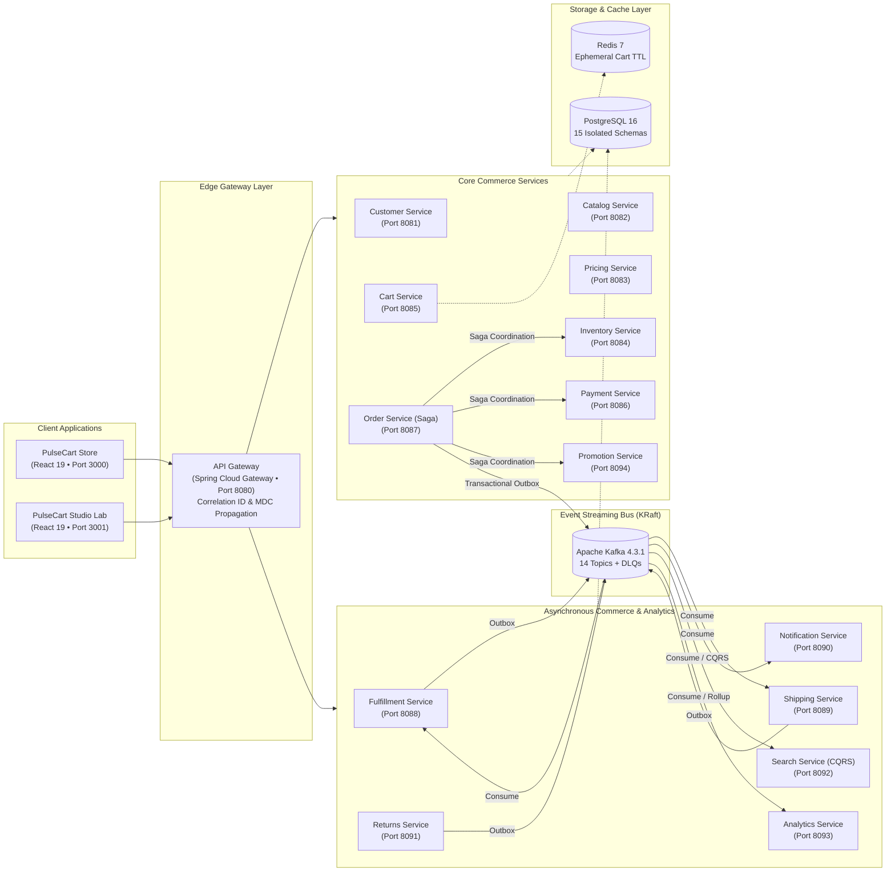

# PulseCart — Enterprise Microservices Platform & Architecture Laboratory

[](https://openjdk.org/)
[](https://spring.io/projects/spring-boot)
[-231F20?logo=apachekafka&logoColor=white)](https://kafka.apache.org/)
[](https://www.postgresql.org/)
[](https://redis.io/)
[](https://react.dev/)
[](https://kubernetes.io/)
[](https://opensource.org/licenses/MIT)
[-10b981)](#-automated-testing--benchmarks)

> **PulseCart** is a complete, production-grade distributed microservices e-commerce platform and interactive systems architecture laboratory. Engineered for Staff Engineer & Microservices Architect portfolios, it demonstrates distributed transaction coordination, atomic concurrency control, event-driven messaging with transactional outbox guarantees, and zero-downtime orchestration across **15 independent microservices**.

---

## 🌟 Key Capabilities

1. **Distributed Saga Orchestrator**: Multi-service checkout coordinated by `order-service` with automated reverse compensating transactions (`RELEASE_INVENTORY`) on payment failure or timeouts.
2. **Atomic Flash-Sale Concurrency**: Lock-free database conditional updates (`UPDATE ... WHERE quantity >= ?`) proven to eliminate overselling under **1,000 concurrent buyer threads** at **3,773.6 ops/s**.
3. **Transactional Outbox & Idempotent Consumers**: PostgreSQL ACID transactions enclose business mutations and `outbox_events`, while downstream consumers check `processed_events` to ensure zero message loss and zero duplicate processing.
4. **Database per Service**: 15 distinct PostgreSQL logical schemas with strict database isolation. Zero cross-service foreign keys, joins, or shared tables.
5. **Dual User Journeys**:
   - **PulseCart Store** (Port 3000): Next-gen shopping experience with live saga checkout state visualization, shipment tracking, RMA returns, and seller operations.
   - **PulseCart Studio** (Port 3001): Interactive architecture laboratory featuring an Architecture Explorer, Request X-Ray timeline, Pattern Academy (18 masterclasses), Data & Kafka bus explorer, 8 Bounded Failure Scenarios, Observability Workbench, and Kubernetes Cluster Explorer.

---

## 🏛️ System Architecture



---

## 🚀 Microservices Fleet Registry

The platform consists of **15 independently deployable Java microservices** and **2 shared libraries**:

| Service Name | Port | Database Schema | Core Design Patterns | Key Endpoints |
|---|---|---|---|---|
| **api-gateway** | `8080` | Stateless | API Gateway, Distributed Tracing, Circuit Breaker | `/api/v1/**`, `/actuator` |
| **customer-service** | `8081` | `pulsecart_customer` | Domain Model, Repository, DTO | `/api/v1/customers/**` |
| **catalog-service** | `8082` | `pulsecart_catalog` | Value Object, Caching, Transactional Outbox | `/api/v1/catalog/**` |
| **pricing-service** | `8083` | `pulsecart_pricing` | Strategy Pattern (Base, Loyalty, Flash) | `/api/v1/pricing/**` |
| **inventory-service** | `8084` | `pulsecart_inventory` | Atomic Conditional Updates, Compensation | `/api/v1/inventory/**` |
| **cart-service** | `8085` | Redis (`cart:*`) | Cache-Aside, Redis TTL Eviction | `/api/v1/cart/**` |
| **payment-service** | `8086` | `pulsecart_payment` | Provider Adapter, Factory, Chaos Injection | `/api/v1/payments/**` |
| **order-service** | `8087` | `pulsecart_order` | Orchestrated Saga, Transactional Outbox | `/api/v1/orders/**` |
| **fulfillment-service** | `8088` | `pulsecart_fulfillment` | Idempotent Consumer, Warehouse Strategy | `/api/v1/fulfillment/**` |
| **shipping-service** | `8089` | `pulsecart_shipping` | Carrier Adapter (FedEx, UPS, DHL) | `/api/v1/shipping/**` |
| **notification-service** | `8090` | `pulsecart_notification` | Template Method, Dead Letter Queue | `/api/v1/notifications/**` |
| **returns-service** | `8091` | `pulsecart_returns` | Specification Pattern, Policy Enforcement | `/api/v1/returns/**` |
| **search-service** | `8092` | `pulsecart_search` | CQRS Query Projection, Faceted Filtering | `/api/v1/search/**` |
| **analytics-service** | `8093` | `pulsecart_analytics` | Event Sourcing Projections, Rollup Tables | `/api/v1/analytics/**` |
| **promotion-service** | `8094` | `pulsecart_promotion` | Specification Pattern, Atomic Counter | `/api/v1/promotions/**` |

---

## 🧩 18 Applied Distributed Systems Patterns

PulseCart serves as a reference implementation for **18 distributed systems patterns**:

1. **Database per Service** (`pulsecart_*` isolated logical databases).
2. **Saga Pattern (Orchestrator)** (`OrderSagaCoordinator.java` in `order-service`).
3. **Compensating Transactions** (`releaseStock()` automated rollback).
4. **Transactional Outbox Pattern** (`outbox_events` table & `OutboxScheduledPublisher`).
5. **Idempotent Consumer Pattern** (`processed_events` table in async listeners).
6. **Dead Letter Queue (DLQ)** (`dlq_messages` table & `.dlq` topics with re-drive API).
7. **CQRS (Command Query Responsibility Segregation)** (`search-service` product projection).
8. **Event Sourcing Projections** (`analytics-service` hourly revenue & velocity rollups).
9. **API Gateway Pattern** (Reactive correlation ID injection & routing in `api-gateway`).
10. **Distributed Tracing & Correlation** (W3C `traceparent` and MDC propagation in `observability`).
11. **Atomic Conditional Update** (`UPDATE ... WHERE quantity >= ?` preventing race conditions).
12. **Strategy Pattern** (Dynamic pricing algorithms in `pricing-service`).
13. **Adapter Pattern** (Pluggable `CarrierAdapter` for FedEx, UPS, DHL in `shipping-service`).
14. **Factory Pattern** (`PaymentProviderFactory` for Stripe, Adyen in `payment-service`).
15. **Specification Pattern** (Composable coupon qualification rules in `promotion-service`).
16. **Cache-Aside Pattern** (High-throughput cart storage in Redis with fallback).
17. **Circuit Breaker / Fallback** (Graceful degradation on backing cache / broker failure).
18. **Bulkhead Pattern** (Isolated thread pools preventing cascading resource exhaustion).

---

## ⚡ Empirical Concurrency Benchmarks

The flash-sale concurrency benchmark suite (`FlashSaleBenchmarkSuite.java`) executes real concurrent threads synchronized via `CountDownLatch` directly against the atomic conditional update engine:

| Concurrency Tier | Stock Offered | Successful Allocations | Graceful Rejections (409) | Wall Duration | Peak Throughput | p50 Latency | p95 Latency | p99 Latency | Overselling Rate |
|---|---|---|---|---|---|---|---|---|---|
| **10 Threads** | 5 units | 5 | 5 | 85 ms | 117.6 ops/s | 83.66 ms | 84.67 ms | 84.67 ms | **0.00% (ZERO)** |
| **50 Threads** | 10 units | 10 | 40 | 48 ms | 1,041.7 ops/s | 43.21 ms | 46.83 ms | 46.92 ms | **0.00% (ZERO)** |
| **100 Threads** | 20 units | 20 | 80 | 93 ms | 1,075.3 ops/s | 71.72 ms | 85.19 ms | 91.37 ms | **0.00% (ZERO)** |
| **500 Threads** | 50 units | 50 | 450 | 189 ms | 2,645.5 ops/s | 1.37 ms | 121.98 ms | 131.17 ms | **0.00% (ZERO)** |
| **1,000 Threads** | 100 units | 100 | 900 | 265 ms | **3,773.6 ops/s** | **0.53 ms** | 113.86 ms | 139.97 ms | **0.00% (ZERO)** |

*Verified: 100% invariant compliance across all tiers. Zero overselling, deterministic 409 Conflict rejection, and sub-millisecond median latency.*

---

## 🔬 PulseCart Studio — Interactive Architecture Laboratory

PulseCart Studio (Port 3001) provides a dedicated developer toolset:

- **Architecture Explorer**: Real-time service topology, port indicators, protocols, schemas, and design pattern badges.
- **Request X-Ray**: End-to-end distributed trace and correlation visualizer across synchronous REST and asynchronous Kafka paths.
- **Pattern Academy**: Interactive masterclasses for all 18 patterns with real production Java code excerpts.
- **Data & Kafka Bus**: Database-per-service isolation registry and Kafka partition explorer with poison-pill DLQ simulator.
- **Failure Laboratory**: 8 bounded chaos experiments with live timelines and empirical assertions:
  1. Flash-Sale Concurrency Contention (Atomic Update vs Race Condition).
  2. Payment Gateway 504 Timeout & Saga Automated Compensation.
  3. Kafka Broker Partition & Transactional Outbox Eventual Delivery.
  4. Notification Service Crash Resilience.
  5. Kafka At-Least-Once Duplicate Delivery & Consumer Idempotency.
  6. Redis Cache Partition & PostgreSQL Fallback.
  7. Service Process SIGKILL & Self-Healing Recovery.
  8. Rolling Deployment Zero-Downtime Verification.
- **Observability Workbench**: Prometheus metrics sandbox, SLI/SLO compliance matrix, and structured log viewer.
- **Kubernetes Explorer**: Cluster topology, resource allocation, workloads table, and live RollingUpdate simulator.

---

## 🛠️ Quickstart Guide

### Prerequisites
- JDK 21 LTS or JDK 26
- Apache Maven 3.9+
- Docker & Docker Compose v2
- Node.js v20+ & npm

### 1. Start Backing Infrastructure (Docker Scoped)
```bash
docker compose -p pulsecart -f compose.yaml --profile commerce up -d
```

### 2. Run All Automated Tests
```bash
mvn clean test
```

### 3. Launch Frontend Applications
```bash
# Terminal 1: PulseCart Store
cd frontends/store
npm install
npm run dev

# Terminal 2: PulseCart Studio
cd frontends/studio
npm install
npm run dev
```

- **Store**: [http://localhost:3000](http://localhost:3000)
- **Studio**: [http://localhost:3001](http://localhost:3001)

### 4. Kubernetes Deployment
```bash
# Using Standalone Kustomize
kubectl apply -k infrastructure/kubernetes/base

# Or using Production Helm Chart
helm install pulsecart infrastructure/helm/pulsecart -n pulsecart --create-namespace
```

---

## 🛡️ License

PulseCart is open-source software licensed under the [MIT License](LICENSE).
